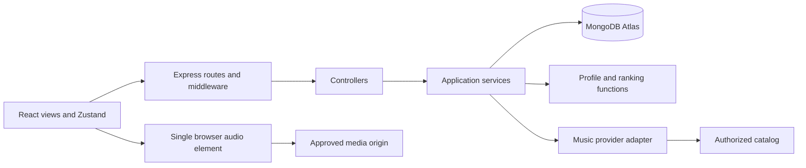

> Current visual authority: the definitive user instructions and `docs/EXPERIENCE_SPEC.md`. Historical screen names, fixed palettes and layout proposals below are superseded. Functional/security/recommendation contracts remain applicable. Cloudinary media imports are documented in `docs/CREATIVE_REBUILD_REPORT.md`.

# AFTERIMAGE — implementation plan and risk report

**Status:** Account/moodspace, real-music, and mood-intelligence slices implemented locally. Current verification and remaining limits are recorded in the milestone handoffs.

**Prepared:** October 26, 2026, Asia/Kolkata.  
**Deadline:** October 27, 2026, 23:59 IST (18:29 UTC).  
**Delivery target:** A deployed, tested application with five complete workflows and real, authorized music playback.

This plan follows `AGENTS.md`, `docs/PRODUCT_BRIEF.md`, `docs/SUBMISSION_CHECKLIST.md`, and `design/REFERENCES.md`. All five local reference images were visually inspected. The repository currently contains planning material, not an application. Estimates assume one implementer, prompt access to service accounts, and roughly 35 hours of elapsed time remaining at planning. They are delivery budgets, not promises that every integration will succeed.

The initial planning task created this document only. The subsequent implementation instruction authorizes scaffolding, dependencies, authentication, and basic moodspace persistence. Commits, pushes, deployment, paid services, and submission still require their appropriate explicit instructions.

### Initial development slice — scope update

The user explicitly limited the first implementation task to the runnable foundation, accounts, and title/description/mood-tag CRUD. This advances M2 and the basic persistence portion of M3. The provider spike in M1 is deferred by that instruction; perform it before starting recommendation or playback implementation. No provider integration, catalog verification, image blocks, quote blocks, energy/theme preferences, recommendations, favorites, or playback is claimed complete.

Implemented: React/Vite/Tailwind shell, self-hosted typography, same-origin API communication, Express/Mongoose startup and database handling, Mongo-backed sessions, Argon2id, CSRF/origin protection, strict validation, owner-scoped CRUD, revision conflicts, form error/recovery states, unsaved-edit guards, and focused database/browser tests. Atlas and production verification await environment credentials and deployment authorization. See `docs/MILESTONE_1.md` for the verified handoff and `README.md` for setup. The original milestones and full workflow acceptance criteria below remain the target for subsequent work.

### User milestone 2 — search, real playback, and saved music

The user's next instruction authorizes the provider gate and literal music search, playback, queue controls, and saving/removing tracks inside owned moodspaces. This advances the playback/search portions of the original M5 independently of M4; mood-profile extraction, ranking, feedback learning, favorites, image blocks, and final cinematic composition remain out of scope for this slice.

Jamendo client credentials were available locally. A real provider/browser feasibility probe succeeded before the full player was built. The implementation uses a provider adapter, one app-level HTMLAudioElement, Zustand queue state, direct authorized media URLs, and explicit source/license attribution. MongoDB stores canonical `Track` metadata and bounded references inside `Moodspace.savedTracks`, with no raw audio or persistent stream URLs. Saved-track deltas are idempotent, owner-scoped, and increment the space revision. The user-requested manual saved-track collection is distinct from the later generated/saved recommendation selection.

Queues persist paused within the current tab session and are cleared on logout. Catalog/stream errors remain visible and recoverable. No automatic Audius fallback is enabled; Jamendo works with the supplied key. Missing keys give a configuration error. Real verification evidence and remaining environment checks belong in `docs/MILESTONE_2.md`; no production deployment is implied.

### User milestone 3 — mood-to-music intelligence

Implemented deterministic profiles and recommendation ranking, real Jamendo candidate retrieval, persisted bounded selections, and authenticated private like/dislike feedback. Optional quote/note/manual image-caption fragments are now editable and persistent. Discover, Compose, and saved-space views share the recommendation panel. Exact dislikes are excluded across the user's spaces; recent tag affinities, saved music, and repeat penalties influence later rankings.

The detailed formula now includes five feature dimensions, genre compatibility, preference affinity, metadata coverage, and repetition penalties to satisfy the user's approved Milestone 3 scope. It replaces the initial section 12 scoring sketch for the implemented version; see `docs/MILESTONE_3.md` for the authoritative formula, source weights, tests, and limitations. No raw image analysis, paid AI, full image editor, humming, lyrics, redesign, or deployment was added. Manual saved tracks remain separate from generated recommendation snapshots.

## Milestone 3.1 implementation update

Listen now saves directly to an owned moodspace and retains playback origin through route/tab restoration. Discover links to the space detail instead of duplicating its recommendations. Existing MongoDB snapshots remain the single durable selection source; failed/empty refreshes retain the last useful result and reads do not call Jamendo. Rule version 2 adds a disclosed Quiet + Restless conjunction, broader retrieval-tag coverage, metadata mismatch penalties, more conservative affinity, and optional persisted five-dimension sound tuning. See `docs/MILESTONE_3_1.md` for the authoritative changes, formula, verification and limitations. No deployment architecture, provider, dependency or broad redesign changed.

## 1. Product identity and boundaries

**Pitch:** Give a personal atmosphere a soundtrack.

AFTERIMAGE turns a collection of images, words, and explicit mood choices into an explainable music selection. The user's space is a reusable input to discovery, and their reactions influence future selections. Music remains the outcome of composing a space, rather than a decorative attachment to a visual collection.

**Primary audience hypothesis:** Students, visual creatives, and reflective listeners who collect references and want music for studying, drawing, unwinding, or recalling a moment. They arrive with an atmosphere in mind but often lack a song or artist name. This is an initial positioning assumption, not completed user research.

**Unique value:** A persistent connection between personal visual references, editable musical intent, actual catalog retrieval, transparent ranking, and individual feedback. A listener can understand and change why a track was suggested.

**Product voice:** Restrained, direct, personal. Use “What should this image feel like?”, “Generate selection,” “Why this track?”, and “Less like this.” Avoid claims that the app understands emotions or performs AI image analysis.

**Success:** A new user can sign up, compose a space, generate a relevant selection, hear a full authorized track, save it, and return after logging out to find their work intact. A second user cannot access that data. Changing musical inputs or feedback has an observable, explainable effect on recommendations.

**Scope decisions:**

- Five workflows, described below. Accessibility and real playback are release requirements, not stretch work.
- Private spaces only. Email/password accounts; no provider account required for listening if the chosen catalog permits it.
- Image URLs and a small set of rights-cleared reference images; no upload infrastructure in the deadline build.
- Structured image/quote/note blocks with simple move-up/down controls; no freeform canvas.
- Explicitly selected image descriptors influence music. Automatic pixel analysis, embeddings, sentiment services, and language models are outside the MVP.
- One generated draft and one saved selection per space. Favorites persist on the server. Queue persists only within the current tab session, with documented restoration behavior.
- Independent music discovery, not a promise of mainstream artist coverage.
- Exclude humming recognition, Shazam matching, synchronized lyrics, social collaboration, public boards, payments, offline music, and complex shaders. Account recovery and email verification are deferred and disclosed; do not present an unimplemented recovery link.

## 2. Exactly five MVP workflows

### W1 — Account and return to a private library

**Journey:** Sign up → arrive in Discover → create personal content → log out → sign in → recover spaces and saved tracks.

**Acceptance criteria:**

- A valid unique email and password create an account; login and logout work with server-managed sessions.
- Errors for invalid input, failed login, and service unavailability are visible and actionable. Passwords are never returned or logged.
- After a browser refresh, the user remains authenticated while the session is valid. After logout, protected API calls fail.
- Two-account tests prove that lists, individual space reads, edits, deletes, recommendations, saved selections, and library mutations enforce ownership.
- A returning user sees persisted spaces and favorites from MongoDB, including in another browser after login. Empty accounts see a useful next action.

### W2 — Compose and maintain a moodspace

**Journey:** Compose → name the space → add description, image reference and its descriptors, quote or personal note → choose moods and preferences → save → reopen/edit → optionally delete.

**Acceptance criteria:**

- Create, view, rename, edit, reorder blocks, and delete a space end to end. Delete requires an in-app confirmation naming the space.
- Support at least an image URL with accessible description, a quote with optional attribution, and a personal text block. All persist after refresh.
- Image descriptors and selected moods are visible and editable. An image without musical descriptors is explicitly decorative until the user supplies them.
- Allow 1–5 predefined moods, energy preference, vocal preference, and one of three atmospheric themes. Theme color alone does not imply musical meaning.
- Save acknowledges a successful database write. Failed saves retain the draft. Navigation with unsaved edits offers stay/discard; Generate first saves and stops if saving fails.
- Broken images have a useful fallback with their description and edit/remove controls. No card obscures its own controls.

### W3 — Generate, explain, and save music from a space

**Journey:** Open a saved space → inspect “Music direction” → Generate → review ranked tracks and reasons → optionally remove choices → Save selection → reopen it later.

**Acceptance criteria:**

- The backend derives a profile from saved content, obtains real catalog candidates, applies AFTERIMAGE ranking, removes duplicates and disliked tracks, and stores the result.
- Return up to 12 tracks, with at least one useful reason grounded in actual matching evidence. Do not pad limited results or invent metadata.
- A controlled test proves that changing an image descriptor while holding other inputs constant changes the profile and eligible-track scores; another proves an energy/mood change affects ranking. Live catalogs need not always return different top tracks.
- Save an ordered subset of 1–12 results; reopen the same saved selection after refresh/login. Regeneration replaces only the draft until the user explicitly replaces the saved selection.
- An edited space marks older selections as based on an earlier version. A generation finishing after a conflicting edit cannot silently overwrite current results.
- Zero results, rate limits, provider downtime, and metadata gaps have honest states. Previous saved selections survive failed generation.

### W4 — Search, listen, manage a queue, and teach preferences

**Journey:** Search tracks or use a generated selection → play → seek/pause/next/previous → add/remove/reorder queue items → save or dislike a track → generate again.

**Acceptance criteria:**

- Search queries a real provider or the explicitly labeled licensed catalog. Results expose track, artist, duration when known, attribution, Play, and Add to queue.
- At least one full authorized recording plays from start to finish on the deployed origin; several tracks pass play, pause, seek, next, previous, and automatic advance tests.
- There is one audio element across route changes. Playing a different track never creates overlapping audio.
- Previous restarts the current track after three seconds; otherwise it moves to the previous item. Next at queue end stops. Queue editing has labeled buttons and needs no dragging.
- Save/unsave and dislike/undo persist in MongoDB. Dislike immediately excludes the exact track from future recommendations and changes related-tag affinity. Repeating a request cannot multiply a preference.
- Queue changes last through same-tab refresh via session storage; restoration is paused and resolves fresh playback URLs. Logout clears private queue and player state. No cross-device queue claim.
- Failed media does not display a moving fake progress bar. Show retry/skip, bound automatic skipping to one pass through the queue, and stop when all items fail.

### W5 — Move between discovery, composition, and focused listening

**Journey:** Explore a mood in Discover → select/open a space → adjust it in Compose → enter Listen → inspect queue → return to the same space without losing playback or edits.

**Acceptance criteria:**

- All three experiences use different task-appropriate compositions while retaining clear, labeled navigation and current-space context.
- The complete W1–W4 path works by keyboard and at 360 px mobile width, tablet width, and desktop width without horizontal page overflow.
- Visible focus, readable contrast, reduced motion, semantic forms, accessible seek/volume controls, and properly managed dialog focus are present.
- Loading, empty, error, dirty, saving, and success states are distinguishable. Core controls remain visible without hovering.
- Listen provides a clear exit, track identity, source/license links, and persistent transport controls; no hidden gesture is required to listen or leave.

## 3. Information architecture and navigation

Use a compact top masthead: AFTERIMAGE wordmark, **Discover / Compose / Listen**, and account menu. A small current-track control near this navigation shows title, pause/play, and a link to Listen when audio is active. It is not a full-width bottom player. On mobile the masthead wraps into two short rows with all three destinations labeled.

| Route | Purpose and primary action | Context behavior |
| --- | --- | --- |
| `/` | Redirect to Discover or sign-in | No separate marketing page in the MVP |
| `/auth` | Sign in / create account | Preserve a safe internal return route |
| `/discover` | Mood exploration, catalog search, personal spaces | Search/mood in URL parameters; saved tracks as an in-page tab |
| `/compose` | Choose a recent space or create one | New-space action opens an unsaved draft |
| `/compose/new` | Compose a new space | Save creates its permanent URL |
| `/spaces/:id` | View a saved moodspace and selection | Edit opens the same entity in Compose |
| `/compose/:id` | Edit content and generate music | Return target remains the originating space |
| `/listen` | Current queue and immersive playback | Optional `spaceId` supplies owned visual context; no queue gives a clear empty state |
| `/about` | Short privacy, credits, music-source and catalog-limit explanation | Public, no personal data |
| unknown route | Useful 404 | Return to Discover |

The account menu offers sign-out and access to saved tracks. Avoid an additional settings product. Use ordinary links, browser back behavior, and route headings. Protect private routes on the server regardless of UI guards. A direct unauthorized space URL gets a neutral not-found response.

## 4. Original layout concepts

### Discover — an editorial music index

**Mode:** Explore, then act. Primary action: select a mood or search for music.

The first viewport pairs a large, narrow editorial heading (“Find a sound for this moment”) with a single atmospheric image region and a clearly labeled search field. Under it, mood terms form a compact typographic index: Quiet, Restless, Melancholic, Warm, Dreamlike, Focused, Intense, Uplifting. Selected terms reveal a vertical track list with reasons and immediate playback actions. This is a deliberate reading sequence, not a wall of identical recommendation cards.

Below, “Your spaces” is an alternating image-and-title list with a useful empty state. “Saved tracks” switches this lower region to a dense music list. No fictional trending activity, user counts, or generic statistics. Mood presets use the same backend profile/ranking pipeline; search preserves provider relevance instead of silently reranking literal artist/title queries.

Desktop uses an asymmetric 7/5 composition above an aligned list. Mobile puts heading, search, mood controls, results, then spaces in a single reading order. Decorative imagery yields space before functional controls do.

### Compose — a structured studio

**Mode:** Operate. Primary action: save a space and generate its music.

A narrow header shows editable name, unsaved/saved state, Save, and Generate selection. Below, a generous composition area occupies roughly two thirds of the width; a quieter inspector contains content controls and “Music direction.” Images, quotations, and notes use a controlled two-column editorial arrangement with a selected lead image. Block order is a normal ordered list in the data model and DOM.

Selecting a block exposes its editor, including “What should this image feel like?” for visual references. Selected image descriptors visibly contribute to the music profile. Add image, Add quote, and Add note are always discoverable. Use move-up/down and lead-image actions, not a drag-and-drop dependency.

Generation opens an in-page results section below the composition: numbered tracks, short explanations, selection checkboxes, and Save selection. Keep the space visible as context; do not squeeze the result into a permanent third panel. On mobile, the order is content, editable block details, music direction, generation results. The Save/Generate action row may be sticky provided it does not cover fields or the software keyboard.

### Listen — an atmospheric listening stage

**Mode:** Experience with reliable controls. Primary action: listen and react.

One large, rights-cleared image or a CSS atmospheric field defines the space. A short user-authored thought or attributed quote can sit in an editorial column, separate from track metadata. Track title, artist, and transport controls occupy a clear area near the lower center, with a readable solid/scrim background. This is the user's space accompanying a recording, not a synchronized lyric screen.

Queue and “Why this track?” are explicit buttons opening accessible dialogs/drawers only when needed. Keep play/pause, seek, previous/next, favorite, and exit visible. The desktop can use an offset image/text balance; mobile uses artwork, title, controls, and optional space text in order. Never time imagery or text to the recording. Decorative transitions respond to user navigation, not alleged audio analysis.

### Lessons from the five inspected images

| Reference | Observed visual qualities | AFTERIMAGE interpretation |
| --- | --- | --- |
| `01-lockscreen-monochrome.png` | Monumental monochrome statue, huge outlined clock, broad pale negative space, subtle bottom waveform | One dominant visual and large type; use space titles rather than a clock. No fabricated waveform |
| `02-lyrics-black.png` | Deep black field, oversized text column, isolated cover and transport, warm artwork | Strong text/image counterweight and concentrated controls; use personal text rather than copied lyrics |
| `03-lyrics-oxblood.png` | Burnt-red field, enlarged soft imagery, bold left text, localized lower-right metadata | Restrained oxblood atmosphere with a protected readable control region |
| `04-music-library-red.png` | Black/crimson palette, oversized title, compact metadata rows, sidebar and multiple panels | Borrow color restraint and information alignment; discard its surrounding application layout |
| `05-immersive-lyrics.png` | Large blurred portrait, dark gradients, text/art overlap, extremely subdued secondary controls | Atmospheric depth with modest effects; improve control visibility and text contrast |

Reference screenshots remain local and ignored by Git. Do not copy their artwork, artist imagery, branding, lyrics, or screen arrangements into the app or public repository.

## 5. Design system and accessibility

### Visual tokens

| Role | Proposed token / rule |
| --- | --- |
| Background | Obsidian `#0B0B0D` |
| Raised surface | Charcoal `#19191C`; opaque surfaces rather than repeated glass panels |
| Primary text | Bone `#F1EDE4` |
| Secondary text | Warm gray `#B7B0A7`; verify contrast on every actual surface |
| Primary action | Crimson `#B92D40` with bone text; verify actual text size/contrast before use |
| Atmospheric accent | Oxblood `#4A1520`, decorative only; never small text on black |
| Focus | Pale warm gold `#F2CE8E`, distinct from error and selection |
| Borders | Muted borders for decoration; stronger boundaries where required to identify controls |
| Shape | Mostly straight edges, 2–6 px radii; pills reserved for mood toggles |
| Spacing | 4/8/12/16/24/32/48/64/96 px scale; 24–48 px desktop gutters, 16–20 px mobile |

**Typography:** Proposed pairing: Barlow Condensed for large display headings and Source Sans 3 for UI/body text, with system sans-serif fallbacks. Use tabular numbers for time and track indices. Headings approximately 48–112 px desktop and 36–56 px mobile; body 16–18 px; metadata at least 13–14 px. Limit uppercase to brief labels. Fonts are proposals from [Google Fonts: Barlow Condensed](https://fonts.google.com/specimen/Barlow+Condensed) and [Source Sans 3](https://fonts.google.com/specimen/Source+Sans+3); verify bundled license files before self-hosting only the required weights. Font acquisition must not block functionality.

**Textures and effects:** Static original grain at low opacity, away from reading surfaces; one restrained shadow/scrim when needed; at most one low-resolution blurred image layer on Listen. No persistent animated noise, large backdrop filters, or WebGL. Themes are Obsidian, Oxblood, and Ash; they share accessible text/control tokens. The user selects a theme; no dependency on cross-origin image sampling.

**Motion:** Approximately 120–180 ms for control feedback and up to 240 ms for panel/navigation transitions. Animate opacity and transforms only where they clarify state. No entrance choreography delaying controls, flashing, parallax, or endless decorative loops. Reduced-motion removes nonessential transforms and animated transitions.

**Responsive behavior:** Desktop composition at about 1024 px and above; tablet collapses the inspector below content; mobile below about 640 px uses one logical column. These are starting points; content determines adjustments. Test 360, 390, 768, and 1440 px, long titles, and 200% zoom. Reserve image aspect ratios to prevent layout shifts. Large titles must wrap without covering controls.

**Accessibility release checks:** Target WCAG 2.2 AA: 4.5:1 normal text, 3:1 large text and meaningful control boundaries; measure rather than assume palette compliance. Use semantic navigation, headings, forms, buttons, and lists. Provide a skip link, visible focus, programmatic field errors, and at least 44 px practical touch targets. Keep selected state identifiable beyond red. Dialogs trap and restore focus and close with Escape. Native range inputs expose seek/volume values; unknown duration disables seek with an explanation. Announce save and track changes politely, not every elapsed second. Decorative backgrounds have empty alternatives; reference images have user-supplied descriptions. Test keyboard use and a screen-reader pass through auth, editor, results, and playback.

## 6. Application architecture

Keep a single repository with `client/` and `server/`, plain JavaScript, and simple npm workspace scripts. Proposed structure only; create it after plan review.

```text
client/src/
  app/                 router, shell, session bootstrap, error boundary
  features/
    auth/ discover/ moodspaces/ recommendations/ library/ player/
  components/          shared buttons, fields, dialogs, track rows, states
  stores/              session, editor, catalog, library, player
  services/            fetch wrapper and API-specific functions
  styles/              Tailwind entry and design tokens
server/src/
  app.js               middleware and routes, independent of listening socket
  server.js            environment validation, Mongo connection, startup
  config/ routes/ controllers/ services/ models/ validation/ middleware/
  providers/           adapter contract, Jamendo, licensed catalog
  recommendation/      vocabulary, profile extraction, scoring, explanations
server/tests/          unit and HTTP/database integration tests
tests/e2e/             full user journeys
```

### Frontend responsibilities

React + Vite + Tailwind CSS + Zustand, with React Router for navigation. Use browser Fetch and AbortController; avoid a second server-state framework for this small application. Feature modules own UI and actions; a shared fetch wrapper handles JSON, credentials, CSRF headers, request IDs, and typed error codes.

The app shell owns one persistent audio element/controller outside route-specific views. Store only serializable player state; keep the audio element reference and event listeners in the controller. Isolate elapsed-time subscriptions so the entire page does not rerender on each media event. Cancel stale searches, use stable keys, lazy-load route code if the bundle warrants it, and load noncritical images lazily. No provider SDK objects or credentials inside components.

Use component state for open menus and simple fields. Shared feature stores coordinate persistent views. Build reusable primitives as needed for the first vertical slice, not an independent component framework. Loading placeholders should preserve geometry; data errors should preserve usable previous content.

### Backend responsibilities

Express owns authentication, ownership, validation, persistence, provider calls, catalog normalization, recommendation scoring, and explanations. Controllers translate HTTP inputs/outputs; services contain business rules; Mongoose models define persistence. Keep scoring functions pure for meaningful tests. No microservices, job queue, WebSockets, or generic repository abstraction.



Audio travels directly from an authorized media origin to the browser. Express returns validated playback metadata; it does not proxy arbitrary audio or user-supplied URLs.

## 7. MongoDB models and persistence

| Model | Important fields | Relationships and indexes |
| --- | --- | --- |
| `User` | normalized email, password hash, display name, timestamps | Unique email index; never serialize hash |
| `Session` | opaque session ID, user ID, CSRF token, expiry | Managed by Mongo session store; expiry/TTL index |
| `Moodspace` | owner ID, title, description, ordered blocks, moods, energy, vocal preference, theme, content revision, timestamps, generated draft, saved selection | Index owner ID + updatedAt; all reads/writes scoped to owner |
| `Track` | provider, provider track ID, title, artist identity/name, duration, artwork/source/license URLs, normalized features with provenance, availability and last verification time | Unique provider + providerTrackId; shared catalog entity, no private notes |
| `UserTrack` | user ID, track ID, saved flag, reaction (`neutral`, `like`, `dislike`), updatedAt | Unique user ID + track ID; index user ID + saved + updatedAt |

Embed blocks in Moodspace: `{id, type, text, imageUrl, altText, sourceUrl, attribution, descriptors}` with only fields valid for that type. Use one order, derived from array position. Images are references, not blobs. Store maximum 20 blocks, including at most 8 images; title 80 characters, description 1,000, note/quote 1,000 each, URLs 2,048, alt text 240. Mood and descriptor values come from finite allowlists. Generation requires at least one explicit mood or image descriptor.

Embed bounded selections in Moodspace to keep saves atomic: a generation ID, content revision, algorithm version, derived profile, catalog mode, up to 12 track references, per-track score components/reasons, and generatedAt. Saved selection is a copied ordered subset with savedAt; later draft generation does not change it. No unbounded generation history before the deadline.

Store catalog identifiers and minimal operational metadata; revalidate provider metadata and availability. Do not store audio bytes or treat playback URLs as permanent identifiers. Proposed metadata refresh age is 24 hours, subject to the provider gate. Persist preference feature evidence only as needed to explain feedback; remove or refresh unavailable metadata when required. Preserve the user's favorite reference as “Unavailable” instead of inventing replacement music.

Deleting a moodspace removes its embedded blocks and selections atomically; global favorites remain. No other owned collection depends on the space, avoiding cascading-delete complexity. Queue context pointing to a deleted space clears, while independently queued tracks can remain until logout. Account deletion is not exposed as a half-built workflow; privacy text describes the actual data/removal process available to this small project.

Use optimistic concurrency: an edit includes its expected content revision; the server matches `_id`, `ownerId`, and revision and increments it atomically. A mismatch returns 409. Generation captures that revision and only attaches results if it is still current. A selection-save request also identifies its generation ID, preventing a stale tab from saving the wrong result.

## 8. API contracts and request flows

All paths below are under `/api`. Successful JSON uses `{data, meta?}`; errors use `{error: {code, message, fieldErrors?, requestId}}`. Never send stack traces or upstream credentials. List endpoints are paginated with a bounded limit; catalog search initially returns 20 results and an explicit next-page action.

| Endpoint | Behavior |
| --- | --- |
| `GET /auth/csrf` | Establish anonymous session and issue CSRF token |
| `POST /auth/register`, `POST /auth/login` | Validate credentials; create/rotate session |
| `GET /auth/me`, `POST /auth/logout` | Bootstrap account; invalidate session and clear cookie |
| `GET /spaces`, `POST /spaces` | Owned list; create space |
| `GET /spaces/:id`, `PATCH /spaces/:id`, `DELETE /spaces/:id` | Owned detail, revision-aware update, delete |
| `POST /spaces/:id/recommendations` | Generate and persist draft from current saved content |
| `PUT /spaces/:id/selection` | Save validated subset/order from named generation |
| `GET /tracks/search?q=...`, `GET /tracks/discover?mood=...` | Catalog search; ranked mood discovery |
| `GET /tracks/:id/playback` | Resolve current playable URL and attribution for a normalized track ID |
| `GET /library` | Owned saved tracks or reaction filter |
| `PUT /library/:trackId` | Idempotently set saved/reaction values; track must exist in catalog |
| `GET /health`, `GET /ready` | Process liveness; bounded database readiness without secrets |

**Authentication flow:** Request → schema and throttling middleware → auth controller → auth service verifies hash/creates account → User and session store → secure cookie plus safe user response. A database failure never becomes a successful login or registration.

**Moodspace flow:** Request → session, CSRF, body/ID validation → space controller → service queries by ID and owner → atomic Mongoose operation → saved entity/revision response. The UI marks saved only after this response.

**Recommendation flow:** Request → session, ownership, generation limits → controller → service loads space + user reactions → profile extraction → provider adapter retrieves candidates → scorer filters/ranks/explains → catalog metadata upsert + conditional space draft write → ordered results and generation metadata. If final revision validation fails, return 409 without attaching an outdated draft.

**Library/feedback flow:** Request → authenticated owner from session + validated track/state → library controller → service enforces reaction semantics → unique UserTrack upsert → authoritative state. Subsequent generation derives preferences from those records; no fragile increment counter.

**Playback/search flow:** Request → authentication, rate and query validation → catalog controller → provider service resolves/normalizes metadata → bounded catalog cache → validated results or playback response. The browser audio element then fetches media directly. Media failures are separate from successful metadata lookup.

After implementing each backend feature, document its concrete request → controller → service → database → response flow and actual verification results in the implementation handoff.

## 9. Security, validation, and errors

Use `express-session` with a Mongo-backed store, not the default development memory store. Cookies carry the session identifier, with HttpOnly, Secure in production, SameSite=Lax, Path=/, no broad Domain, and a proposed seven-day maximum lifetime. Rotate sessions and CSRF tokens on authentication; explicitly destroy sessions on logout. Configure proxy trust narrowly for the chosen deployment. These choices follow the [Express session documentation](https://expressjs.com/en/resources/middleware/session/).

Use Argon2id password hashing with at least 19 MiB memory, two iterations, and parallelism one, then benchmark on the target host. If the package cannot run there, use Node's asynchronous scrypt with a documented OWASP-equivalent configuration, unique random salts, and constant-time comparison. Do not silently downgrade to a fast hash. See [OWASP password storage guidance](https://cheatsheetseries.owasp.org/cheatsheets/Password_Storage_Cheat_Sheet.html). Password policy: 15–128 characters, allow spaces/paste/password managers, no composition puzzles. Email normalization and unique-index errors are handled consistently.

Protect every state-changing request, including login, with a synchronizer CSRF token and exact allowed-origin checks. Accept JSON only for these endpoints. Use one production origin to avoid third-party cookie dependencies; local Vite proxies `/api`. A UI route guard is convenience, never authorization. Server queries always derive user identity from the session, never request `ownerId`.

Validate using a single backend schema library such as Zod, plus Mongoose constraints. Reject unknown fields, malformed IDs, unexpected object operators, unbounded pagination, and invalid enum values. Build update objects explicitly. Render user text as plain text; no raw HTML or Markdown rendering in the MVP. Use a bounded JSON body, initially 64 KB.

Allow only HTTPS image URLs without credentials and with valid hostnames; reject localhost/private IP literals and unsafe protocols. The server does not fetch these URLs. Use image elements with no-referrer policy and graceful errors; disclose that external image hosts receive requests. Provide bundled, rights-cleared images when external links fail. Provider requests go only to configured origins, and playback URLs must pass the adapter's approved-host/redirect policy. Never build a general URL proxy.

Add security headers and a tested CSP covering scripts, styles/fonts, approved media origins, and image policy. Apply bounded per-IP auth throttling and per-user search/generation limits; initial budgets: 10 auth attempts per 15 minutes, 30 searches per minute, and 5 generations per minute. Confirm these against host memory and provider quotas. A single-instance in-memory limiter is acceptable for the deadline, with its restart/multi-instance limitation documented.

Use 400 for malformed requests, 401 for missing/expired session, 404 for missing/unowned resources, 409 for duplicate/conflicting revision, 422 for validly shaped but invalid content, 429 for throttling, and 502/503 for upstream/service failures. Handle provider error payloads even when HTTP status is 200. Logs contain request IDs and timings, not passwords, cookies, private text, or credential-bearing URLs.

## 10. Music-provider feasibility and licensing gate

### Proposed primary: Jamendo, conditional on a real spike

Official documentation describes client-ID access, search/tag queries, music metadata, stream URLs, and separate download permissions. The adapter can request `include=musicinfo`, normalize tags and speed when present, and use the returned `audio` URL. These are documented capabilities, not verified results from this application's credentials. [Jamendo tracks documentation](https://developer.jamendo.com/v3.0/tracks).

Jamendo's published API terms permit noncommercial use, require compliance with each track's license, creator/provider credit and a track backlink, and constrain caching/offline use. They also require a privacy policy. Commercial use needs a separate arrangement. The terms page is old despite being the current linked page; check the account's accepted agreement during setup. Do not equate public availability, download permission, or API success with all necessary rights. [Jamendo API terms](https://devportal.jamendo.com/api_terms_of_use).

**Implementation policy:** Keep the project noncommercial. Show artist, source, track link, and license link wherever track details are presented. No download/offline feature, stream modification, timed slideshow, or synchronized lyrics. Inspect the exact selected licenses for the visual listening context and demo video. Prefer clearly suitable permissions; ambiguous tracks stay ineligible. This policy is a design decision pending the gate, not a declaration that particular recordings are cleared.

**What remains unverified:** Developer registration/client ID, accepted account terms and quota, availability of useful tracks for every selected mood, real response completeness, current media hosts/redirects, full-track playback and seeking, behavior on deployed HTTPS and mobile browsers, and rights for the exact demo recordings. No authenticated provider call or browser playback test has been performed in this planning task.

### Alternatives and exclusions

| Option | Decision and evidence |
| --- | --- |
| Jamendo | First candidate; isolated adapter and strict gate before building deeply around it |
| Rights-cleared catalog | Deadline fallback preserving real audio and ranking, with explicit smaller-catalog labeling |
| Spotify | Not on the critical path: Web Playback SDK requires Premium and its policy restricts synchronization with visual media. Access and suitability would need separate review. [Official getting-started guide](https://developer.spotify.com/documentation/web-playback-sdk/tutorials/getting-started) |
| YouTube | Not an invisible music backend; policies prohibit isolated audio and hidden background players. A compliant video product would change the experience. [YouTube developer policies](https://developers.google.com/youtube/terms/developer-policies) |
| Scraped streams / arbitrary MP3 URLs | Excluded; neither source reliability nor playback rights are established |

### Time-boxed gate: first 90 minutes after implementation authorization

1. Obtain the user's legitimate developer access through environment configuration; never reuse sample credentials as production credentials.
2. Query at least three contrasting profiles and a literal search. Inspect real metadata, empty fields, license/source links, API error payloads, and rate-limit behavior.
3. Build a minimal actual audio check after implementation is authorized: play at least three eligible tracks, seek, pause/resume, change tracks, and finish one recording. Test a deployed HTTPS origin after deployment authorization.
4. Record the tested track IDs, license URLs, time, browsers, and results without secrets. Confirm allowed artwork use and attribution as well as music use.
5. If access, rights, or playback cannot be established within the gate, select the licensed-catalog path before implementing provider-specific UI. Do not spend the remaining day chasing multiple platform approvals.

### Licensed-catalog fallback

Acquire approximately 15–20 real recordings spanning at least three contrasting mood groups, with at least three eligible choices per group. Use original recordings with documented permission or tracks whose composition and recording rights permit this hosting/playback. CC BY material can permit redistribution with credit, license links, and modification notices, but each work's source and rights still need verification. [CC BY 4.0 deed](https://creativecommons.org/licenses/by/4.0/).

Maintain a manifest with title, artist, original source, license/version, attribution, permission evidence/date, duration, host URL, manually curated tags, and feature provenance. Host only permitted files on the deployment's static assets or an approved object store; verify MIME type, byte-range seeking, bandwidth, and HTTPS. Do not obtain this fallback by caching Jamendo streams. A recorded demo also needs applicable recording/synchronization permission; a screenshot of a license label alone is not evidence of ownership.

Implement the fallback as the same adapter backed by real catalog records in MongoDB and real audio files. Search, profile ranking, favorites, and explanations all still run normally. Label it “Licensed starter catalog” and disclose its size; never market it as a full catalog or hardcode per-space recommendations. Tests may use synthetic fixtures, but production results must correspond to actual licensed recordings. If no lawful catalog is ready, audio delivery is blocked: report that honestly instead of showing simulated playback.

## 11. Provider adapter and real playback

The provider boundary exposes conceptual operations `search`, `getCandidates`, `getTrack`, and `resolvePlayback`. Normalize into provider/key, title, artist, duration, artwork/source/license URLs, tags, optional energy/vocal/acoustic values, provenance, and availability. Keep unknown features as null. UI and scorer use this contract, never provider response shapes. Expose the active catalog label to the UI.

Use bounded upstream requests: at most three candidate queries per generation, at most 50 results each, deduplicated to at most 100 candidates. Set an overall 12-second generation deadline with bounded per-request timeouts. Retry at most once for transient failures within the deadline; obey Retry-After and do not retry authentication/validation errors. Cache candidate metadata briefly, initially five minutes, subject to provider terms; apply user exclusions after shared-cache retrieval. Never cache personal rankings across users.

Before playback, resolve the track again when stale or after a media error. Return the fresh URL without persisting it in browser storage. Recheck removed tracks and rights status; unavailable items remain identifiable but unplayable. A known working fallback catalog is offered explicitly on provider outage, rather than silently changing what a saved track represents.

Start audio from a user gesture and handle rejected `play()` promises. Browsers may block autoplay; returning users see “Resume listening” rather than automatic sound. The UI derives `playing`, `buffering`, duration, progress, and failure from real media events. See [MDN's autoplay guide](https://developer.mozilla.org/en-US/docs/Web/Media/Guides/Autoplay).

Do not require Web Audio or cross-origin waveform analysis. Basic media playback and seeking are the gate; if a waveform is ever added, it must represent actual audio data and remain optional. No timer-only playback, fake equalizer, or preview presented as a full song.

## 12. Explainable recommendation logic

### Inputs and profile extraction

Use a versioned, small vocabulary mapping the eight UI moods and image descriptors to catalog tags and approximate energy. Example mappings to validate during the provider gate: Quiet → ambient/relaxing, low energy; Restless → electronic/rock, high energy; Melancholic → sad/melancholic, lower energy; Warm → acoustic/soul, moderate-low energy; Dreamlike → ambient/dream, low-moderate energy; Focused → instrumental/chillout; Intense → rock/electronic, high energy; Uplifting → happy/pop, moderate-high energy. These are editorial mappings, not scientific emotion measurements.

- Explicit space moods contribute 55% of the tag profile.
- User-selected descriptors on image references contribute 30%. Average across images so adding duplicates cannot overwhelm intent.
- Recognized words/phrases in title, description, notes, image captions, and quotes contribute 15%. Use a small documented English lexicon; deduplicate words and skip matches under simple immediate negation. Unrecognized language contributes no inferred tags.
- Normalize available source weights to sum to one. No recognized text is neutral, not evidence of sadness or calm.
- An explicit energy slider in `[0,1]` overrides energy defaults from selected descriptors. Without an override, use their weighted mean. Vocal preference is Any / Prefer instrumental / Prefer vocals, a soft preference rather than a guaranteed filter.
- Theme color, image filename, and raw image pixels do not determine mood. The user is asked what the reference evokes. The profile inspector shows each signal's source and lets the user edit the source content.

Do not send private quotes or notes to the music provider. Send only derived allowlisted catalog tags and any deliberate search query. Explain the supported language and modest interpretation in product copy.

### Candidate retrieval and eligibility

Retrieve candidates from up to three highest-weight tag groups. If too few candidates match, relax the least important tag constraint once; preserve mood evidence and label broader results. Literal search stays a separate relevance-oriented operation. On the licensed catalog, query the real stored tracks through the same adapter.

Normalize provider tags using a versioned synonym map. Convert known speed categories to energy estimates (`verylow=.1`, `low=.3`, `medium=.5`, `high=.7`, `veryhigh=.9`). These are application estimates based on catalog metadata, not measured BPM. Curated fallback features are marked manually assigned. Missing metadata stays unknown.

Before ranking, exclude duplicates by provider/key, known unavailable or rights-ineligible tracks, and the user's exact disliked tracks. Require positive mood-tag overlap for normal mood recommendations. When none remains, return an honest insufficient-match result with an explicit “Explore broader music” action; do not label random tracks as matches.

### Scoring specification, version 1

For each eligible track calculate components in `[0,1]`:

| Component | Weight | Definition |
| --- | --- | --- |
| Mood match `M` | .55 | Sum of profile tag weights matched by the track's normalized tags |
| Energy match `E` | .20 | `1 - abs(profileEnergy - trackEnergy)` when both are known |
| Vocal match `V` | .10 | 1 for preferred known category, 0 for opposite; omit for Any/unknown |
| Feedback affinity `F` | .15 | Mean tag affinity mapped from `[-1,1]` into `[0,1]`; cold start is .5 |

`coverage` is the sum of weights with available evidence. `score = 100 × weightedMean(available components) × (0.7 + 0.3 × coverage)`. This reduces confidence for sparse metadata instead of treating unknowns as perfect matches. Use stable provider/key order for exact ties. Persist component values and evidence with the generation; scores are internal ranking values, not scientific match percentages.

Then apply a diversity pass: select at most two tracks per artist in the first 12. Return fewer tracks if that cap cannot be met; do not silently reinsert disliked tracks. No popularity component, randomness, or paid recommendation service is necessary in version 1.

### Feedback and modest learning

`UserTrack` holds one current reaction per user/track. Save defaults a neutral reaction to like; unsaving removes the bookmark but does not silently undo a separately meaningful reaction. Dislike clears saved status, removes upcoming queue occurrences, excludes the exact track from later generations, and can be undone to neutral. Show this behavior clearly in the feedback controls.

For each tag, aggregate distinct current track reactions, `+1` for like and `-1` for dislike. Define `affinity(tag) = (likes - dislikes) / (likes + dislikes + 4)`; the smoothing prevents one click from dominating. Track feedback affinity is the mean across its known tags, default zero before mapping to `[0,1]`. Derive from current records on generation, so toggling reactions and retries cannot inflate counts. Bound the read to the most recent 200 non-neutral reactions for the deadline build and disclose that scope in technical documentation.

This is real personalization with transparent rules. Current mood remains the dominant signal. Skipping and listening duration do not count as dislikes; no hidden behavioral tracking is required. Saved selections remain snapshots even as future rankings change.

### Worked example and proof

A user adds a rainy-window image and selects Quiet and Dreamlike for it, writes “A quiet evening,” selects Melancholic for the space, sets energy to .2, and prefers instrumental music. Those explicit image labels and recognized words strengthen low-energy tags. An eligible track with `M=.9`, `E=.9`, `V=1`, and cold-start `F=.5` scores 85. An otherwise eligible track with `.3`, `.3`, `0`, and `.5` scores 30. These numbers are illustrative test inputs, not catalog claims.

An explanation can say “Matches Dreamlike from your image and your instrumental preference” only if the actual track has those features. A track with unknown vocals cannot get that reason. Show at most two strongest true reasons plus optional “Based on limited catalog metadata.” Disliking the first track removes it from the next generation; related tags receive a small negative affinity.

Required proof tests: image descriptor sensitivity; explicit energy override; bounded text influence; repeated words/images; absent/unknown metadata; reaction undo/idempotence; exact dislike exclusion; artist diversity; deterministic ties; stale-generation rejection; fallback catalog ranking. Fixture data must be clearly test-only.

## 13. Zustand state ownership

| Store | Owns | Persistence and invalidation |
| --- | --- | --- |
| Session | Safe user object, bootstrap status, CSRF token | Memory; bootstrap from `/auth/me`; session secret stays in HttpOnly cookie |
| Editor | Current draft, original revision, dirty/save status, selected block | Memory; explicit save to server; navigation guard; no private draft in localStorage |
| Catalog/results | Search query/results, request status, generated selection references | Memory; search params in URL; abort/ignore stale responses |
| Library | Owned saved tracks and reaction cache | MongoDB is authoritative; rollback failed optimistic actions |
| Player | Queue IDs/order, current index, playback state, time/duration, volume, context | Queue IDs/index in user-scoped sessionStorage; memory-only media URLs; restore paused |

The audio element is the source of truth for actual playback status. MongoDB is the source of truth for saved content. Zustand coordinates UI; it is not the database. On logout or account change, stop audio, clear all private stores and per-user session storage, abort pending requests, and prevent late responses from repopulating the previous user's cache. A 401 preserves an unsaved in-memory draft only until the user deliberately signs out or changes account; it offers reauthentication rather than silently discarding edits.

## 14. Deployment and production configuration

**Recommended topology:** One Render Node web service serves Express `/api` and the built Vite frontend on the same HTTPS origin, with MongoDB Atlas for persistent data and sessions. This keeps the required frontend/backend separation in source while avoiding cross-site authentication and a second hosting configuration. Render documents direct Express deployment. [Render Express guide](https://render.com/docs/deploy-node-express-app).

Use the smallest approved always-on instance for reliable grading if the user accepts its current price. No purchase is assumed. The free alternative can sleep after 15 idle minutes and take about a minute to resume; local writes are ephemeral. A free deployment must disclose cold-start behavior and be tested from an idle state, not described as always-on production hosting. Do not create artificial keep-alive traffic to conceal it. [Render free-service limitations](https://render.com/docs/free).

If Render is unavailable, package the same Node process and Vite build for an already-approved Node host. Splitting onto a static host plus a separate API is a last resort because cookie/proxy configuration would need fresh testing. Atlas availability, account eligibility, region, and quotas must be checked during setup; do not assume a particular free tier.

**Configuration checklist:**

- Pin a supported Node LTS version compatible with the chosen Vite/Express versions during implementation, commit a lockfile when commits are authorized, and document exact versions. Use ESM consistently.
- Define root scripts for development, lint, unit/integration tests, build, end-to-end tests, and production start. Proposed deployment commands are `npm ci && npm run build` and `npm start`; validate once these scripts exist.
- Build Vite assets into `client/dist`; Express serves assets and falls back to the SPA only for non-API HTML navigation. Unknown API routes remain JSON 404s. Listen on the host's `PORT` and `0.0.0.0`.
- Document `NODE_ENV`, `PORT`, `APP_ORIGIN`, `MONGODB_URI`, `SESSION_SECRET`, `MUSIC_PROVIDER`, `JAMENDO_CLIENT_ID`, and optional licensed-media base URL in example env files. No secret uses a `VITE_` prefix. Relative `/api` needs no production frontend secret.
- Validate required variables at startup. Use least-privilege database credentials, separate development/test databases, and deployment IP access entries. Atlas admits connections only from configured IP/CIDR entries. [Atlas access-list documentation](https://www.mongodb.com/docs/atlas/security/ip-access-list/).
- Verify the host's outbound ranges rather than opening Atlas globally as a default. Test indexes, session expiry, reconnect behavior, and readiness timeout.
- Store no uploads or mutable data on the web-service filesystem. If fallback audio is bundled, it is an immutable rights-cleared build asset, not runtime storage.
- Add request IDs, non-sensitive errors and timings, bounded logs, graceful shutdown, and `/health`/`/ready`. A provider outage should not make editing stored spaces unavailable.
- Confirm HTTPS cookies, CSP media hosts and redirects, refreshed deep links, actual range seeking, and a fresh private-browser login on the deployed origin.
- Disable automatic deployment unless explicitly authorized, so later pushes do not accidentally publish unfinished work. Preserve the last verified build and record a rollback procedure.

Prepare deployment configuration and instructions during implementation, but execute pushes/deployments only when the user explicitly requests them. Ask for any paid option with its actual price and concrete prepared artifact; do not hold local implementation while waiting for that optional choice.

## 15. Testing and release gates

Use a small meaningful suite: Vitest for pure logic and selected React interactions; Supertest with an isolated MongoDB test database for API/ownership flows; Playwright for browser journeys. Avoid tests that merely repeat static styles. Automated media fixtures test controller behavior, while live authorized audio testing proves the integration; one cannot substitute for the other.

| Layer | Essential checks | Pass condition |
| --- | --- | --- |
| Recommendation units | Scoring, feature provenance, missing data, feedback, exclusions, diversity, input sensitivity | Deterministic expectations and no unsupported explanations |
| HTTP/database | Auth, owned CRUD, two-account isolation, duplicate saves, validation, revision conflicts, provider failure | Correct status/data and verified database effects |
| Player interactions | One audio element, route continuity, stale URL refresh, rejection, queue bounds | No overlap, false playing state, or infinite failure loop |
| Browser journeys | W1–W5 including refresh/login persistence | Full path against real backend/database |
| Live integration | Actual catalog search, multiple tracks, seeking, one complete recording, attribution | Evidence recorded from deployed origin |
| Visual/accessibility | Desktop/mobile/zoom, keyboard, reduced motion, contrast, focus dialogs | No blocked task or critical accessibility defect |
| Production | Clean install/build, deep links, cookies, readiness, idle startup, secret scan | Fresh browser can complete demo without developer tools |

Important failure cases to exercise: expired session during editing; two tabs editing the same space; generation finishing after edit/delete; network loss during save; empty library; long text; broken image; non-English text; unknown duration; playback rejected by autoplay policy; removed/expired stream; provider 429/timeout/invalid JSON/HTTP-200 error; all candidates disliked; all queue items unavailable; double-clicked Save; lost database connection; logout during an in-flight request; malformed IDs and injection payloads; missing production env; deployment restart.

Initial performance budgets are engineering targets to measure, not current results: warm owned-data API responses under 500 ms at p95 for a small demo load; generation succeeds or exits within 12 seconds; warm play begins within about 3 seconds on normal broadband; initial application JS under roughly 250 KB gzip; no layout jumps from images. Cold starts and third-party latency are reported separately. Reduce oversized imagery/effects before adding optimization infrastructure.

Perform one batched visual pass at desktop and mobile, fix findings together, then one confirmation pass. Functional regressions still require testing. Record actual lint/build/test commands and results, including skips and external blockers. A green mocked test is not evidence that a music integration works.

## 16. Dependency-ordered milestones and deadline budget

Plan for approximately 20–24 focused implementation hours plus rest, review, and submission buffer. Begin only after review. Account provisioning, provider access, deployment permission, and demo recording logistics must be surfaced early. If start time slips, remove optional polish first; do not compress final authorization/audio tests out of the schedule.

| Order | Deliverable and dependencies | Effort budget | Exit gate / target IST |
| --- | --- | --- | --- |
| M0 | Review this plan; choose provider gate and hosting budget assumptions | 30 min | Scope understood; next implementation instruction received |
| M1 | Real provider/license/audio spike; inspect Atlas/hosting access; establish fallback feasibility | 90 min | One viable catalog path; target Oct 26, 15:00 |
| M2 | Minimal scaffold, DB/session/security plumbing, complete W1 UI→API→DB; build/deploy configuration | 3 h | Two users isolated, login persists; target Oct 26, 18:00 |
| M3 | Complete W2 including structured editor, image descriptors, owned CRUD, revisions | 3 h | Refresh/edit/delete all work; target Oct 26, 21:00 |
| M4 | Complete W3: provider adapter, real candidates, profile/scoring/reasons, saved selection | 3 h | Inputs affect ranking; saved results persist; target Oct 27, 00:00 |
| M5 | Complete W4: search, full audio, queue, favorites, reactions and next-generation learning | 3 h | Actual recording and persistence pass; target Oct 27, 10:00, allowing overnight rest |
| M6 | Complete W5: final page compositions, mobile/keyboard, empty/loading/error states | 2 h | All journeys usable across target widths; target Oct 27, 12:00 |
| M7 | Authorized deploy, production smoke and regression fixes, licensing/credits confirmation | 3 h | Public HTTPS loop verified; target Oct 27, 15:00 |
| M8 | README, architecture/setup/env, demo recording, submission rehearsal and final defects | 3 h | Artifacts ready by Oct 27, 18:00 |

Deployment smoke testing should happen as early as M2 if explicitly authorized; M7 is the final production gate, not the first exposure to hosting. Integrate relevant tests inside each milestone. Keep the feature sequence vertical: finish each workflow before expanding the next. Build minimal real playback during M1 and re-use it in M5; do not create a throwaway mock player.

**Hard checkpoints:**

- By Oct 26, 15:00 or the end of the 90-minute provider gate: switch to the licensed catalog if the primary path is still unproven. Asset acquisition consumes the same budget; availability is not assumed.
- By Oct 27, 12:00: no new feature categories; cut theme variants, additional layouts, and elaborate transitions if needed.
- By Oct 27, 15:00: deployed core loop working. If behind, prioritize reliability and disclosure over aesthetic expansion.
- By Oct 27, 18:00: feature freeze; fix only release blockers, create documentation and demo evidence.
- Target submission by Oct 27, 21:00, leaving nearly three hours for link/access/form problems. The absolute deadline remains 23:59 IST.

If fewer hours remain at implementation start, rebase checkpoints explicitly. A realistic reduction keeps auth, owned CRUD, real ranking, full authorized audio, saving, and accessible navigation. It can reduce catalog size and visual customization. Removing authentication or a complete workflow requires discussing the scope tradeoff with the user, as the product brief requires.

## 17. Prioritized risk report and fallback decisions

| Priority / risk | Trigger and impact | Mitigation / fallback |
| --- | --- | --- |
| Critical: provider access or rights fail | No eligible playable tracks after M1; entire music loop blocked | Time-box spike; use verified licensed catalog through same adapter; report blocked if neither exists |
| Critical: hosting/DB access delayed | Cannot verify public persistence/login | Configure early; authorized deploy smoke at M2; use already-approved Node host if needed; no local-only success claim |
| Critical: ownership/auth defect | Account B reads or mutates A's resources | Owner-scoped queries and two-account tests; release blocker, never scope-cut |
| High: sparse mood metadata | Generic rankings despite decorative spaces | Visible image descriptors, bounded lexicon, provenance/coverage, curated catalog tags; no invented audio features |
| High: stream or browser failure | Metadata exists but playback/seek fails | Direct-media spike, fresh URLs, actual media events, bounded skip; rights-cleared alternate catalog |
| High: schedule overrun | Core loop not complete by midday Oct 27 | Cut optional themes/motion/extras; retain five coherent workflows and reserve release time |
| High: fallback content unavailable | Licenses/hosting not verified in acquisition budget | Treat as a real blocker; do not disguise synthetic data or unauthorized files as a fallback |
| Medium: cookie/CORS/CSP problems | Local login/audio works but deployed version fails | Same origin, exact production config, deployed smoke early |
| Medium: free host sleeps/limits | Grader hits slow start or suspension | Prefer approved always-on hosting; disclose/test free alternative; inspect quota before submission |
| Medium: broken external images | Composition loses its lead image | Local rights-cleared defaults, alt text, placeholder and edit action; music descriptors remain usable |
| Medium: race conditions | Old edit/generation replaces newer state | Revision predicates, generation IDs, canceled client requests and idempotent preference writes |
| Medium: visual effects harm usability | Poor contrast, motion discomfort, slow mobile | Opaque controls, static texture, bounded blur, reduced motion, measured checks |
| Medium: documentation/demo mismatch | Demo depicts fixtures or a different catalog than deployment | Record deployed build, identify catalog honestly, include known limits and actual verification |

**Fallback ladder:** primary provider → explicitly labeled licensed catalog → if lawful audio is still unavailable, disclose the blocker and seek a revised submission scope. Never replace real playback with a timer. Provider outages should preserve editing, saved metadata, and account access; database outages disable saves with honest errors rather than pretending local state is persisted.

## 18. Final demo and submission checklist

### Proposed 3–5 minute demo

1. **0:00–0:30:** State the problem and catalog scope; sign in from a clean browser.
2. **0:30–1:30:** Create a named space, add a rights-cleared image with descriptors, a personal thought/quote, and explicit musical preferences. Save.
3. **1:30–2:20:** Generate; show a track's evidence-based explanation and the Music direction summary. Save the selection.
4. **2:20–3:10:** Play actual audio in Listen; pause/seek/advance and open the queue. Show source/license credit. Capture audible music only when demo-video rights are established.
5. **3:10–3:50:** Favorite one track, dislike another, regenerate and explain the exclusion/feedback effect.
6. **3:50–4:30:** Refresh/relogin to show persistence, briefly show mobile layout, and name the architecture and known limits.

A separate QA record confirms one recording played fully; a short demo clip alone does not prove full-track playback. Do not expose credentials, personal email, private content, or service secrets in the recording. Demonstration content must use original text and cleared imagery/music, not the five inspiration screenshots.

### Release and handoff checks

- [ ] All five workflow acceptance criteria pass, with evidence or accurately documented blockers.
- [ ] Fresh private-browser sign-up/login works; second-user authorization tests pass.
- [ ] Moodspace edits, selection, favorites, and reactions survive refresh and later login.
- [ ] Image descriptors visibly influence the profile; backend ranking and learning tests pass.
- [ ] Real deployed catalog search works; at least one authorized recording plays fully; transport and failure recovery work.
- [ ] Queue scope is documented accurately: same tab, restored paused, cleared on logout.
- [ ] Desktop/mobile, keyboard, contrast, reduced motion, loading/empty/error states checked.
- [ ] Deployed frontend/deep links, API readiness, Atlas access, sessions, and production configuration verified.
- [ ] Track/artwork/font credits and license evidence complete; reference screenshots stay untracked and unshipped.
- [ ] Secrets absent from source, logs, demo, and Git history; example env files contain placeholders only.
- [ ] Relevant lint/tests and `npm run build` pass; report real commands/results and any skipped live checks.
- [ ] README explains installation, env setup, start/build/test commands, deployment, data model, recommendation formula, catalog limits, and known limitations.
- [ ] Architecture diagram and request flows match the shipped implementation; this plan records approved deviations.
- [ ] Meaningful commits and an accessible repository are prepared/executed only on explicit user instruction; no accidental screenshot publication.
- [ ] A 3–5 minute demo is accessible with the required sharing permissions, and its media rights are verified.
- [ ] Open deployment, repository, and demo links in private browsing and check from another device/network where possible.
- [ ] Complete the submission form linked in the repository checklist: [final submission form](https://forms.gle/sBy4sfqyiRG2Zpom9). Actual form fields and upload/access requirements have not been inspected in this task; check them early in the submission rehearsal.
- [ ] Submit by the 21:00 IST target with explicit user authorization, retain confirmation, and verify before the 23:59 IST deadline.

### Decisions for plan review

The proposed defaults are: private accounts; exactly five workflows; user-labeled image meaning; transparent rule-based recommendations; conditional Jamendo integration with a real licensed-catalog fallback; explicit saves and bounded selections; one Render origin plus Atlas; persistent favorites and a session-only queue. Provider access, exact recording rights, hosting cost approval, and deployment authorization remain external gates. Actual initial-slice verification is recorded in `docs/MILESTONE_1.md`; future catalog, playback, and production capabilities remain unverified until implemented and tested.

## Approved final UI implementation — October 27, 2026

The user's final transformation request and `FINAL_ART_DIRECTION.md` supersede earlier aesthetic wireframes and all four rejected generated concepts. The implemented visual pass uses the eleven approved local references as inspiration, with original CSS treatments, actual provider artwork and user-selected images. Functional architecture and Milestone 3.1 remain authoritative.

The user explicitly authorized the small image-reference extension: `Moodspace.images` holds up to 12 ordered `{ id, url, alt, caption }` entries, validated public HTTPS URLs, bounded text and unique IDs. Existing owner/revision-scoped CRUD persists them; captions join the existing bounded text-signal group. No upload storage, image proxy, pixel inference, new provider or additional secret is introduced. External-image HTTPS requests are allowed by image CSP only; media policy remains restricted to existing authorized streams.

The app now presents an editorial search/space atlas, a modular visual moodspace, an immersive Listen/focus view, a persistent compact player and a modal queue. Audio host/controller and Zustand transport state are retained. Motion uses short CSS opacity/transform transitions with reduced-motion alternatives; no animation or WebGL dependency was needed. Detailed component map, actual verification and limitations are recorded in [FINAL_UI_IMPLEMENTATION.md](FINAL_UI_IMPLEMENTATION.md). Deployment remains a separate authorized action; no commit, push or deployment is part of this pass.
